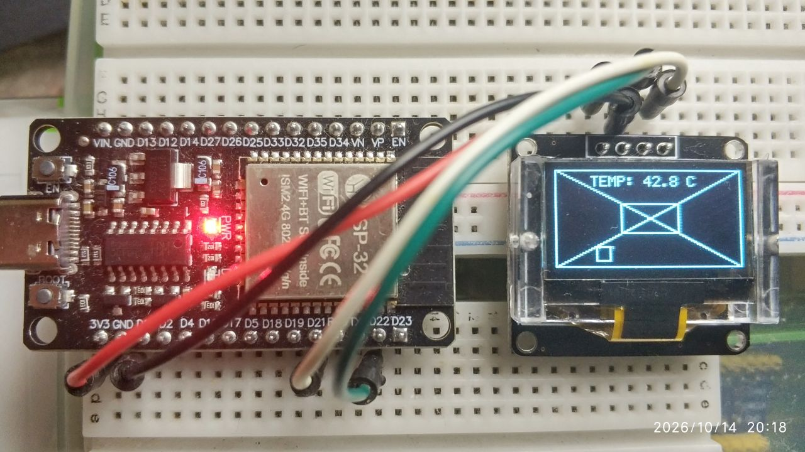

<div align="center">

# ESP32 SSD1306 OLED Monitor (ESP-IDF v6)

[](https://github.com/espressif/esp-idf)&nbsp;[](https://www.espressif.com/)&nbsp;[](LICENSE)

[🇷🇺 Русский](#русский) | [🇬🇧 English](#english)



</div>

---

<a name="русский"></a>

## 🇷🇺

Минималистичный, высокоэффективный проект управления 0.96" OLED-дисплеем (128x64, SSD1306) по шине I2C на базе микроконтроллера **ESP32 DevKitCv4** под управлением **ESP-IDF v6.0+**.

Проект демонстрирует аппаратную инициализацию контроллера дисплея (включая встроенный Charge Pump), отрисовку растровой графики, собственный легкий шрифт 5x7 и опрос встроенного в кристалл термодатчика в реальном времени.

### ⚡ Особенности реализации

- **Нативный I2C драйвер ESP-IDF v6:** использование современного `driver/i2c_master.h` на повышенной частоте 400 кГц (Fast Mode).
- **Защита от сдвига координат (Warm Reset Protection):** принудительный сброс указателей адреса страницы и столбца (`0x21` и `0x22`) перед каждой передачей кадра. Дисплей сохраняет стабильную синхронизацию даже при нажатии кнопки `EN` без снятия питания.
- **Канонический Render Loop:** сборка кадра с нуля без артефактов и затирания фоновых слоев.
- **Адаптация под двухцветную матрицу:** статус-бар с температурой ядра чипа расположен строго в верхней зоне ($Y=0..15$), а динамическая графика — в синей ($Y=16..63$).

---

### 🔌 Схема подключения

> [!CAUTION]
> **Внимание к распиновке модуля!** На рынке присутствуют две ревизии плат: у одних первый пин — `GND`, у других — `VCC`. Перед подачей питания обязательно сверьте шелкографию на вашей плате!

| Вывод OLED (0.96") | Вывод ESP32 DevKitC V4 | Описание линии                           |
| :----------------: | :--------------------: | :--------------------------------------- |
|      **VCC**       |        **3V3**         | Питание 3.3 В (от внутреннего LDO платы) |
|      **GND**       |        **GND**         | Общий провод (земля)                     |
|      **SCL**       |      **GPIO 22**       | Тактовая линия шины I2C (I2C0 SCL)       |
|      **SDA**       |      **GPIO 21**       | Линия данных шины I2C (I2C0 SDA)         |

---

### 🛠️ Настройка и запуск через графический интерфейс VSCode

Для работы используется редактор **VSCode** с официальным расширением **ESP-IDF Extension**. Все действия выполняются через нижнюю статус-панель редактора.

#### 1. Права доступа к порту (разово в Linux)

Если порт платы еще не открывается, добавьте текущего пользователя в группу `dialout`:

```bash
sudo usermod -a -G dialout $USER
```

_(После этого необходимо перезайти в систему)._

#### 2. Выбор целевого чипа и COM-порта

На нижней панели VSCode кликните на соответствующие пункты:

- **Клик на `[Target]`** $\to$ выберите **`esp32`**.
- **Клик на `[Port]`** $\to$ выберите порт подключения платы (например, `/dev/ttyUSB0`).

#### 3. Настройка размера Flash-памяти

1. На нижней панели нажмите иконку **⚙️ (ESP-IDF: SDK Configuration Editor)**.
2. В строке поиска введите: `Flash size`.
3. В параметре **Flash size** выберите значение **`[ваш размер] MB`**.
4. Нажмите кнопку **Save** в правом верхнем углу вкладки конфигурации.

#### 4. Сборка и запуск в один клик

На нижней панели нажмите иконку **🔥 (ESP-IDF: Build, Flash and start a monitor on your device)**.

VSCode автоматически:

1. Скомпилирует проект.
2. Зальет прошивку в чип.
3. Откроет терминал мониторинга порта.

_(Для остановки монитора нажмите `Ctrl + ]`)._

---

<a name="english"></a>

## 🇬🇧

A minimalist, highly efficient reference project for driving a 0.96" OLED display (128x64, SSD1306) over the I2C bus using an **ESP32 DevKitCv4** microcontroller and **ESP-IDF v6.0+**.

The project demonstrates hardware initialization of the display controller (including the internal Charge Pump DC-DC step-up), custom raster graphics rendering, a lightweight embedded 5x7 ASCII font, and real-time on-chip core temperature monitoring.

### ⚡ Key Features

- **Native ESP-IDF v6 I2C Driver:** Utilizes the modern `driver/i2c_master.h` running in Fast Mode at 400 kHz.
- **Warm Reset Protection:** Issues pointer reset commands (`0x21` and `0x22`) prior to each frame update. Eliminates frame shifting and memory offset wrapping during ESP32 warm resets (`EN` button) without cycling display power.
- **Clean Render Loop:** Implements a full-frame redraw pattern (`Clear -> Background -> Foreground -> Present`), preventing graphical artifacts.
- **Dual-Color Matrix Alignment:** Status bar with internal CPU core temperature is placed in the top yellow segment ($Y=0..15$), while vector geometry and animations reside in the bottom blue segment ($Y=16..63$).

---

### 🔌 Hardware Wiring

> [!CAUTION]
> **Check the module pinout!** Some 0.96" OLED boards have `GND` as the first pin, while others have `VCC`. Always inspect the silkscreen on your physical PCB prior to applying power!

| OLED Pin (0.96") | ESP32 DevKitC V4 Pin | Description                          |
| :--------------: | :------------------: | :----------------------------------- |
|     **VCC**      |       **3V3**        | 3.3V Power supply (from onboard LDO) |
|     **GND**      |       **GND**        | Ground reference                     |
|     **SCL**      |     **GPIO 22**      | I2C Clock (I2C0 SCL)                 |
|     **SDA**      |     **GPIO 21**      | I2C Data (I2C0 SDA)                  |

---

### 🛠️ Configuration & Run via VSCode GUI

Optimized for **VSCode** with the official **ESP-IDF Extension**. All steps are performed using the bottom status bar icons.

#### 1. Port Permissions (One-time Linux setup)

Ensure your user has access to serial devices:

```bash
sudo usermod -a -G dialout $USER
```

_(Requires user log out and log in to take effect)._

#### 2. Select Target & COM Port

Using the VSCode bottom status bar:

- Click on **`[Target]`** $\to$ select **`esp32`**.
- Click on **`[Port]`** $\to$ select your board device node (e.g., `/dev/ttyUSB0`).

#### 3. Flash Memory Size Setup

1. Click the **⚙️ (ESP-IDF: SDK Configuration Editor)** icon in the status bar.
2. In the search box, type: `Flash size`.
3. Set the **Flash size** dropdown to **`[your size] MB`**.
4. Click **Save** in the top-right corner.

#### 4. Build, Flash & Monitor in One Click

Click the **🔥 (ESP-IDF: Build, Flash and start a monitor on your device)** icon in the status bar.

VSCode will automatically:

1. Compile the firmware.
2. Flash the target microcontroller.
3. Open the interactive UART monitor.

_(Press `Ctrl + ]` to exit the monitor)._
